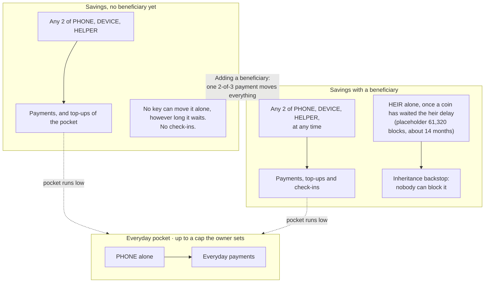
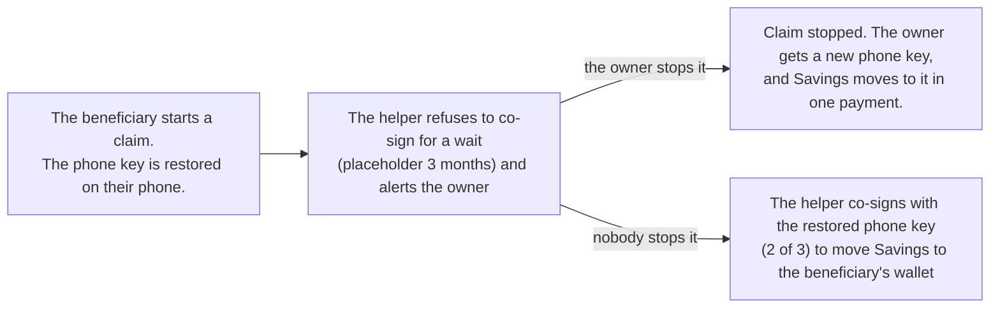
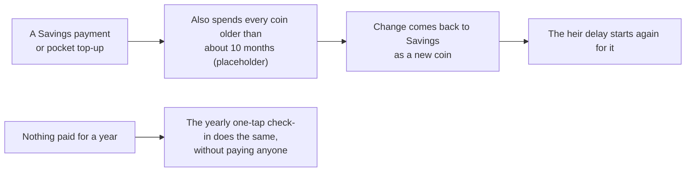

# Twofold

**Simple to use, hard to lose, and ready to pass on — without a company as the gatekeeper.**

Twofold is a bitcoin wallet app that makes keeping your own bitcoin as easy as a banking app, without trusting a company to hold it for you.

You use your phone for everyday spending. For savings, moving money takes two of your three keys: your phone, a second device (like a tap-to-sign card), and a helper service. Losing any one key doesn't lose your money, and no single key — including ours — can move it alone.

You can replace the helper anytime, and if Twofold ever disappeared you could still get your bitcoin out with free, open-source tools. Down the road, Twofold also lets you plan who inherits your bitcoin, so your family isn't locked out if something happens to you.

## Status

Pre-alpha. **Milestone 1** is in progress: proving the Savings wallet rules on test bitcoin (regtest and signet) before any app work. Nothing here touches real bitcoin.

## Who can move the bitcoin

There's one balance, in two parts:
- a small **everyday pocket**, which the phone key alone can spend;
- **Savings**, for everything else.

Savings starts with no beneficiary. Adding one moves it, in one payment, to a new wallet that also has an inheritance path.

**Enforced by Bitcoin itself.** These rules hold even if Twofold disappears.

- **DEVICE** is the owner's second key: a hardware wallet, a card, or an old phone or tablet.
- **HELPER** is a replaceable helper service. It co-signs; it can never move Savings alone.
- **HEIR** is the beneficiary's own key.

**Enforced by the helper, not by Bitcoin.** The helper-assisted claim is the fast route to inheritance. The on-chain heir path above stays as the backstop if Twofold is gone or misbehaves. It isn't built yet, and its wait is a placeholder (brief 3.12).

The helper never decides that someone has died; it only waits.

**Payments count as check-ins** (the payment rule, with a beneficiary). Each coin's heir delay counts from when that coin confirmed, and spending a coin starts its clock again. So every Savings payment and pocket top-up also spends the coins getting close to a check-in, and sends the change back to Savings.

- **Receiving doesn't count:** it moves no old coin, and it needs no approval, so it proves nothing.
- **It's a setting, on by default.** Spending old coins together links them, so it can be turned off for privacy. Then the yearly check-in does all the refreshing.

The exact descriptors, and the tests for every path, are in [`crates/twofold-savings`](crates/twofold-savings/README.md#spending-paths). The pocket isn't built yet (brief 3.11).

## Where things are

| Path | What it is |
| --- | --- |
| [`docs/milestone-1.md`](docs/milestone-1.md) | Builder brief for the current milestone |
| [`docs/phone-key-backup.md`](docs/phone-key-backup.md) | Phone key backup: the design, which security devices can unlock it, threats and decisions. A prototype is in `twofold-savings`. |
| [`docs/exit-drill.md`](docs/exit-drill.md) | Leaving without Twofold: both shapes of Savings with Bitcoin Core alone, the P2WSH shape in Sparrow's format, and the Taproot shape with Liana |
| [`crates/twofold-savings`](crates/twofold-savings/README.md) | Savings wallet rules, their regtest tests, and every assumption behind them |
| [`crates/twofold-cli`](crates/twofold-cli/README.md) | `twofold`, a developer command-line tool for Savings on test networks |
| [`docs/design.md`](docs/design.md) | Design references: brand sheet, screens, type and color |
| [`CLAUDE.md`](CLAUDE.md) | Ground rules for anyone (or any AI assistant) working in this repo |
| [`SECURITY.md`](SECURITY.md) | How to report a vulnerability (privately, through GitHub) |

## Dependencies

Twofold holds keys, so every dependency is a risk worth weighing.

- **A new dependency needs a reason in its PR**: what it's for, why an existing crate or a few lines of our own code won't do, and who maintains it.
- `cargo deny check` (policy in [`deny.toml`](deny.toml)) must pass. It fails on:
  - known security advisories and yanked crates
  - two versions of `bitcoin`, `secp256k1` or `miniscript` in one build
  - any source other than crates.io
  - licences that aren't permissive
- `Cargo.lock` is committed, so every build uses the same, reviewed versions.

## Checks

Every pull request runs [CI](.github/workflows/ci.yml):
- the build, `cargo clippy -D warnings` and the tests, including the regtest tests on throwaway nodes
- `cargo deny check`
- a 60-second run of each fuzz target in [`fuzz/`](fuzz/)

Two checks run by hand:
- [Fuzz (long)](.github/workflows/fuzz-long.yml) fuzzes each target for longer.
- The [exit drill](docs/exit-drill.md) spends Savings through Liana and Bitcoin Core.

The full-length 61,320-block test runs locally: `cargo test -- --include-ignored`.

## License

MIT. See [`LICENSE`](LICENSE).
