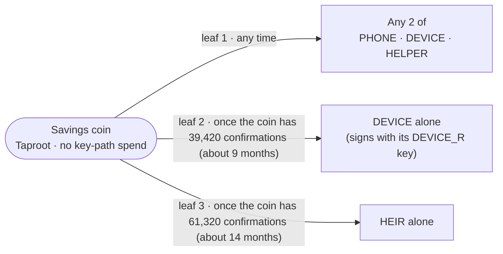

# twofold-savings

The rules for the Twofold **Savings** wallet, as a Taproot descriptor, plus the checks Twofold runs before it builds or finalizes a Savings spend.

**Test networks only.** The library refuses mainnet, and all tests run on throwaway regtest nodes with keys generated fresh in memory. The delays are placeholders until an outside Bitcoin reviewer signs off.

## Spending paths



| Who approves | Allowed? |
| --- | --- |
| Any 2 of PHONE, DEVICE, HELPER | Yes, any time |
| DEVICE alone | Only once the coin has waited the device delay |
| HEIR alone | Only once the coin has waited the heir delay |
| PHONE alone, HELPER alone | Never, however long the coin waits |
| HEIR + HELPER, HEIR + PHONE | Not before the heir delay (then HEIR could act alone anyway) |
| HEIR + DEVICE | Not before the device delay (then DEVICE could act alone anyway) |
| DEVICE with both its keys | Not before the device delay |

The descriptor, with placeholder names for the keys:

```text
tr(UNSPENDABLE/<0;1>/*,
   { multi_a(2, PHONE/<0;1>/*, DEVICE/<0;1>/*, HELPER/<0;1>/*),
     { and_v(v:pk(DEVICE_R/<0;1>/*), older(39420)),
       and_v(v:pk(HEIR/<0;1>/*),     older(61320)) } })
```

## Using it

```rust
let keys = SavingsKeys::new(phone, device, device_r, helper, heir)?; // tpub…/<0;1>/* keys
let policy = SavingsPolicy::new(keys, Delays::default(), Network::Regtest)?;
let descriptor = policy.export_descriptor();          // for backup, Liana, Bitcoin Core
let psbt = spend::build_spend(&mut wallet, policy.delays(), spend::Path::Device, |b| { /* recipients, fee */ })?;
HolderKey::from_secret_str(&key_text)?.sign(&mut psbt)?; // one holder approves (test networks only)
let tx = spend::finalize(&wallet, &signed_psbt)?;     // refuses if too early or not enough approvals
```

## Finding for the reviewer: BDK alone finalizes delayed spends too early

**What we found.** BDK 3.2.0 with miniscript 12.3.7 will finalize a DEVICE-alone or HEIR-alone spend as soon as the input's sequence matches the leaf's delay, however young the coin is. When BDK finalizes, it gives miniscript three satisfiers: the PSBT itself, a height check, and an age check. miniscript combines them with **OR** (`impl_tuple_satisfier` in `miniscript/src/miniscript/satisfy.rs`). The PSBT satisfier only compares the delay with the input's sequence, so it says "yes" before the coin is old enough, and BDK's age check is never consulted. BDK's own code has a `// TODO: test >= / >` beside that check.

**Why funds were never at risk.** The network enforces the delay itself (BIP 68 and `OP_CHECKSEQUENCEVERIFY`). The node rejects such a spend with `non-BIP68-final`, and the tests confirm it every time. The risk was in the product: Twofold would have handed the user, or an heir, a spend that can never confirm.

**The fix.** `spend::check_delays` reads each input's sequence. If the sequence asks for a block-based delay, it compares that delay with the coin's confirmations as of the next block, and returns `Error::TooEarly` if the coin is too young. Time-based delays are refused outright. Both `spend::build_spend` and `spend::finalize` run this check, so Twofold refuses before building a delayed-path spend and again before finalizing one. Where BDK only knows an upper bound for a coin's confirmation height, the computed age can only come out too young, never too old.

**How it's tested.**
- `library_refuses_to_build_a_device_spend_one_block_early` and `…_heir_spend_one_block_early`: the library refuses one block early and builds one block later.
- Every forbidden-path test requires both a library refusal and a node rejection.
- `bdk_alone_would_finalize_an_early_delayed_spend` pins BDK's behaviour, so we notice if it ever changes.
- With the check switched off, 8 of the 12 forbidden-path tests fail.

A related detail: BDK's age check compares against the current tip, which makes it one block stricter than the network. The network judges a spend by the block it would go in, so `finalize` passes BDK `assume_height = tip + 1`. Twofold and the network then agree to the block. The tests check this boundary exactly: refused at N − 1 confirmations, accepted at N.

## Assumptions

Every assumption about policy, timelocks, fees or signing in this crate, per the repo rules.

### Policy

- The policy is exactly the one in `docs/milestone-1.md`. The **recovery contact** path (for example contact + helper after a wait) is left out on purpose, and has to be decided before Milestone 2.
- **DEVICE holds two keys:** DEVICE for the 2-of-3 path and DEVICE_R for its delayed path. In the tests they come from the same device seed on different accounts. Liana expects one key per spending path, and SegWit v0 miniscript forbids repeated keys. It doesn't change who can spend.
- All five keys must be different extended keys. `SavingsKeys::new` refuses a repeat.
- **After 61,320 confirmations, DEVICE alone and HEIR alone can both spend**, so whichever acts first wins. For the reviewer to judge.
- **A stolen DEVICE plus a missed check-in is enough to spend once the device delay has passed.** The check-in (a later PR) is what keeps the device delay from opening.

### Delays

- Defaults: device 39,420 blocks (about 9 months), heir 61,320 blocks (about 14 months). Placeholders, and configurable through `Delays::new`.
- They are **relative** delays (`older`, BIP 68/112), counted in **blocks only**. Delays are stored as `u16`, which caps them at the 65,535-block consensus limit and rules out time-based values. The heir delay must be longer than the device delay, and the device delay at least 1 block.
- Each coin's clock starts when **that coin** confirms. New deposits start their own clock. Change from any Savings spend goes to a new Savings address, so it gets a fresh clock too. A check-in must therefore include every coin.
- The 61,320-block heir delay sits 4,215 blocks (about 1 month) below the cap, which leaves little room to lengthen it.
- "Has N confirmations" means the funding block counts as the first. A spend with a delay of N can go in the block N blocks after the coin's block, which is when the coin has N confirmations from the next block's point of view.

### Script type and keys

- **Taproot.** Only the leaf actually used is revealed on-chain, so everyday 2-of-3 spends don't reveal the inheritance path. The 2-of-3 leaf sits highest in the tree, so it gets the shortest proof.
- **No key-path spend.** The internal key is an extended key whose public key is BIP 341's NUMS point H (`0250929b…3ac0`). Its chain code is SHA256 of the five Savings public keys, in order. Nobody can know its private key at any index. Because the chain code differs per wallet, different wallets don't share an internal key, and anyone with the five public keys can recompute it. This follows the approach Liana uses. Byte-for-byte compatibility with Liana's import is **not yet verified**; that's part of the exit drill.
- The test keys use derivation paths `m/87'/1'/0'` (and `m/87'/1'/1'` for DEVICE_R), with `/<0;1>/*` for receive and change. These paths are **test-only**; the real ones get decided with the reviewer.
- Keys must be test-network extended public keys (`tpub`). Mainnet keys and a mainnet `Network` are both refused.

### Fees

- The library doesn't choose fees: `build_spend` lets the caller set the fee rate.
- Tests use a fixed 2 sat/vB, because regtest has no fee estimates. That's above the default relay minimum.
- No fee bumping yet. BDK's default sequence for the 2-of-3 path signals RBF, and the delayed paths' sequences (the delay itself) do too.

### Export

- `export_descriptor()` returns the public descriptor with `<0;1>` and its checksum. `export_receive_and_change()` returns separate receive and change descriptors.
- Neither contains private keys, but both reveal every Savings address and balance, so treat them as private.
- Bitcoin Core reads the export and derives exactly the addresses BDK hands out (`tests/export.rs`).
- Import into Liana or Sparrow is **not yet tested**. Sparrow may not support custom timelocked Taproot policies.

## Not yet verified

To check during the exit drill (importing the export into Liana or Sparrow and spending without Twofold):

- **Liana's internal key.** Our unspendable internal key follows Liana's approach. Whether Liana derives a byte-identical one is unverified.
- **How Liana writes a key used in two paths.** Liana may express DEVICE and DEVICE_R as the *same* xpub with different multipath steps: `xpub/<0;1>/*` for one path and `xpub/<2;3>/*` for the other. `SavingsKeys::new` currently refuses that, because it compares only the extended key. If Liana does this, relax the check to allow the same xpub when the derivation paths differ, while still refusing any overlap that would make two roles derive the same key.
- **Import at all.** Whether Liana and Sparrow import this descriptor, and whether Sparrow supports custom timelocked Taproot policies.

## Tests

Tests start a throwaway `bitcoind` per test. Each one runs in a temp folder, on a random local RPC port, with P2P off. It never touches a node you already run. Point `BITCOIND_EXE` at your binary.

Bash (Git Bash, macOS, Linux):

```bash
BITCOIND_EXE="C:\Program Files\Bitcoin\daemon\bitcoind.exe" cargo test
```

PowerShell:

```powershell
$env:BITCOIND_EXE="C:\Program Files\Bitcoin\daemon\bitcoind.exe"; cargo test
```

The full-length test mines all 61,320 blocks and takes about 10–12 minutes, so a plain `cargo test` skips it. Run everything, including that test, with:

```bash
BITCOIND_EXE="C:\Program Files\Bitcoin\daemon\bitcoind.exe" cargo test -- --include-ignored
```

```powershell
$env:BITCOIND_EXE="C:\Program Files\Bitcoin\daemon\bitcoind.exe"; cargo test -- --include-ignored
```

| File | What it proves |
| --- | --- |
| `src/policy.rs` (unit) | Reading the rules back out of the descriptor matches a rule written independently. Checked for all 32 combinations of the five keys, at ages around each delay. Also names each forbidden case. |
| `tests/allowed_paths.rs` | Each allowed path spends on regtest, through the expected leaf, at exactly its delay |
| `tests/forbidden_paths.rs` | Each forbidden case, tried through all three leaves, is refused by Twofold **and** rejected by the node. This includes the case of signing a shorter sequence to skip a delay. |
| `tests/default_delays.rs` | The real 39,420 / 61,320 delays open at exactly those confirmations (ignored by default) |
| `tests/export.rs` | Bitcoin Core derives the same addresses from the export |
| `tests/harness.rs` | The harness's hand-built spends are valid when they have enough signatures, so a rejection elsewhere is the policy's doing |

Keys are generated in memory for each test and never printed, logged or written to disk. While mining, the harness moves each throwaway node's clock forward 10 minutes per block (`setmocktime`). Without that, a node refuses blocks mined thousands per second once their timestamps run 2 hours ahead.

The [`twofold` command-line tool](../twofold-cli/README.md) wraps all of this.

## Not here yet

- The check-in (send-to-self that restarts every delay)
- The signet demo
- The Liana/Sparrow exit drill
- The recovery contact path
