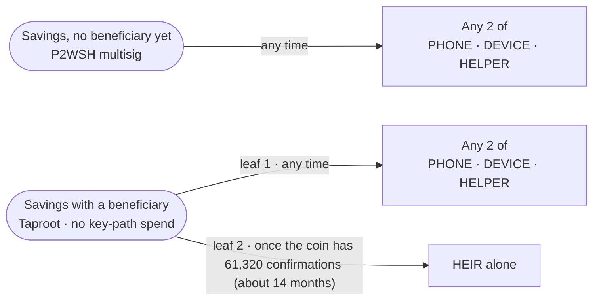

# twofold-savings

The rules for the Twofold **Savings** wallet, as a descriptor in one of two shapes, plus the checks Twofold runs before it builds or finalizes a Savings spend.

**Test networks only.** The library refuses mainnet, and all tests run on throwaway regtest nodes with keys generated fresh in memory. The delays are placeholders until an outside Bitcoin reviewer signs off.

## Spending paths

Savings has two shapes. It starts with no beneficiary, as plain 2 of 3 in the standard P2WSH multisig format; adding a beneficiary moves it to a Taproot wallet with the heir path, in one transaction ([below](#adding-a-beneficiary)).



| Who approves | No beneficiary | With a beneficiary |
| --- | --- | --- |
| Any 2 of PHONE, DEVICE, HELPER | Yes, any time | Yes, any time |
| PHONE, DEVICE or HELPER alone | Never, however long the coin waits | Never, however long the coin waits |
| HEIR alone | n/a (no HEIR key) | Only once the coin has waited the heir delay |
| HEIR + PHONE, HELPER or DEVICE | n/a | Not before the heir delay (then HEIR could act alone anyway) |

There is no card-only path: brief 3.8 removed DEVICE alone after 9 months. The phone key backup covers a lost phone, and removing it takes away a stolen card's slow route to Savings.

The descriptors, with placeholder names for the keys:

```text
wsh(sortedmulti(2, PHONE/<0;1>/*, DEVICE/<0;1>/*, HELPER/<0;1>/*))

tr(UNSPENDABLE/<0;1>/*,
   { multi_a(2, PHONE/<0;1>/*, DEVICE/<0;1>/*, HELPER/<0;1>/*),
     and_v(v:pk(HEIR/<0;1>/*), older(61320)) })
```

### Why two formats

The deciding question for each shape is how many independent tools can get the bitcoin out if Twofold disappears.

| | No beneficiary: `wsh(sortedmulti(2, …))` | With a beneficiary: Taproot policy |
| --- | --- | --- |
| **What it needs to express** | Plain 2 of 3, nothing more | 2 of 3, plus HEIR alone after a relative timelock |
| **Who can import and spend it** | Bitcoin Core, Sparrow, Electrum, Nunchuk and other standard multisig wallets. The exit drill checks Bitcoin Core end to end, and checks the export against Sparrow's own descriptor parser. | Liana and Bitcoin Core, both checked end to end by the exit drill. Sparrow refuses Taproot descriptors with script paths (in its source). Electrum and Nunchuk weren't checked for this shape. |
| **Why not the other format** | Liana v15.0 refuses a policy with no timelocked path: "A Liana policy requires at least one recovery path" (`liana/src/descriptors/analysis.rs`, `MissingRecoveryPath`). A Taproot 2-of-3 would only add Bitcoin Core. | Only the heir path needs miniscript and a timelock. Taproot keeps it hidden until it's used: an everyday 2-of-3 spend reveals only the 2-of-3 leaf. |
| **Privacy and fees** | A 2-of-3 spend reveals the whole multisig script, and is somewhat larger than a Taproot script-path spend. | Only the leaf used is revealed. |

- **`sortedmulti`** orders the three keys by their public key at each address, the way every standard multisig wallet expects, so the same keys give the same addresses everywhere.
- **Moving between them.** Adding a beneficiary spends every coin from the P2WSH wallet into the Taproot wallet in one 2-of-3 transaction. There's no way back to P2WSH except a new wallet and another move.

## Using it

```rust
let keys = SavingsKeys::new(phone, device, helper, Some(heir))?;       // or None: no beneficiary yet
let policy = SavingsPolicy::new(keys, Delays::with_heir(DEFAULT_HEIR_DELAY)?, Network::Regtest)?; // or Delays::none()
let descriptor = policy.export_descriptor();          // wsh(sortedmulti(…)) or tr(…), for backup and other wallets
let psbt = spend::build_spend(&mut wallet, policy.delays(), spend::Path::Heir, |b| { /* recipients, fee */ })?;
HolderKey::from_secret_str(&phrase)?.sign(&mut psbt)?; // one holder approves with their recovery phrase (test networks only)
let tx = spend::finalize(&wallet, &signed_psbt)?;     // refuses if too early or not enough approvals
```

## Adding a beneficiary

A wallet's script can't change, so adding a beneficiary means a new wallet and one transaction moving Savings there (`migrate`):

- `migrate::wallet_with_heir(&from, heir, Delays::with_heir(n)?, min_heir_delay)` makes the new wallet: the same PHONE, DEVICE and HELPER plus HEIR, with an heir delay of at least `min_heir_delay` blocks.
- `migrate::build_move(&mut wallet, &from, &to, min_heir_delay, fee_rate)` drains every confirmed coin, through the 2-of-3 path, to the new wallet's first receive address: one network fee.
  - The PSBT carries the HEIR key and heir delay it was built for, in a proprietary field (`twofold`/`move`) that other software ignores. It marks the PSBT as a move; it's compared, never trusted.
  - Unconfirmed coins are left out, as in a check-in. They stay spendable by 2 of 3 and can be moved once they confirm.
- `migrate::check_move(&wallet, &psbt, &from, &to, min_heir_delay)` checks a move against `to`, the wallet the **signer's own settings** say it goes to. It refuses unless:
  - `to` has `from`'s PHONE, DEVICE and HELPER, a beneficiary, and at least the minimum heir delay;
  - the PSBT is marked as a move and names the same HEIR key and delay as `to` (`Error::MoveNotAsSetUp` otherwise);
  - it uses the 2-of-3 path and spends every confirmed coin and nothing else;
  - it has exactly one output, to `to`'s first address. A second output is refused even if it also pays `to`.
- **Where a move goes is never taken from the PSBT.** Whoever prepares a move could otherwise choose HEIR and the delay. Each signer rebuilds `to` from its own settings, so a move built for a different HEIR key, a shorter delay or an extra output is refused at `sign` and again at `broadcast` (`tests/migrate.rs`). The CLI keeps those settings in the old wallet's `savings.json` (`moving_to`, set by `add-heir`), and treats a PSBT that pays the new wallet as a move even if it isn't marked. `sign` still shows HEIR's full key and the delay, in blocks and about how long, so approvers can compare them with the beneficiary's.
- **Replacing a key** will be a move too, with the replacement key in the same settings. Until it's built, a move to a wallet with other keys is refused (`Error::MoveToWrongWallet`).
- Changing the beneficiary is the same move, from a wallet that already has one.
  - **The old wallet keeps its heir path.** Anything left in it, such as a coin that was unconfirmed at the move or a later payment to one of its addresses, stays claimable by the former HEIR after its delay, and nothing reminds anyone to check in there any more. Move those coins too.

## Check-in

Only Savings with a beneficiary has a check-in: without one, nothing opens with time, so there's nothing to restart, and the library refuses one (`Error::NoCheckinWithoutHeir`).

Each coin's delay clock starts when that coin confirms. A **check-in** spends every confirmed Savings coin, through the 2-of-3 path, into one new Savings address, so the heir delay starts again from zero. It must happen before the oldest coin reaches the heir delay; after that, HEIR alone could spend it.

- **Interval rule.** `checkin::CheckinRule::new(interval, margin, delays)` requires `interval + margin <= heir delay`, with both at least 1 block. So an interval at or past the heir delay is always refused. Defaults: interval 52,560 blocks (about 12 months), margin 8,760 blocks (about 2 months). Against the 61,320-block heir delay, they use it exactly. All three are placeholders.
- **Coin status.** For each coin, `checkin::coins` gives:
  - blocks until its heir path opens (none without a beneficiary)
  - **due:** the coin has reached the interval
  - **overdue:** its heir path is already open

  `checkin::reminder` sums these up for the whole wallet.
- **Building and checking.**
  - `checkin::build_checkin` drains every confirmed coin to one new change address through the 2-of-3 path, and marks the PSBT with a proprietary field (`twofold`/`checkin`) that other software ignores. Unconfirmed coins are left out.
  - `checkin::check_checkin` refuses a check-in that leaves out any confirmed coin, spends an unconfirmed one, pays anywhere but one Savings address, or uses the heir path.
  - The CLI runs the check again at `sign` and at `broadcast`, so a coin that confirmed after the check-in was built gets it refused.
- **Why it can't be the heir path.** The check-in's sequence carries no delay, so the heir leaf can't be satisfied. HEIR alone can't approve it even when its path is open, and the network agrees (CSV fails). The tests check both.

### The payment rule: payments count as check-ins

Brief 3.12: every Savings payment and pocket refill also spends the coins close to needing a check-in, so it refreshes them at no extra step. The yearly check-in is then only needed when nothing has been paid for a while.

- **`checkin::PaymentRule::new(window, checkin_rule)`.** A coin is due for a refresh once it's within `window` blocks of its check-in being due, that is, at `interval - window` confirmations. `1 <= window < interval`.
  - Default window: 8,760 blocks (about 2 months), `DEFAULT_REFRESH_WINDOW`. With the default interval, that means coins older than 43,800 blocks, about 10 months. A placeholder, like the other timelocks.
- **`spend::build_payment(wallet, delays, path, rule, configure)`** is `build_spend` plus the rule. A 2-of-3 payment also spends every coin `checkin::due_for_refresh` lists, as required inputs, whatever coin selection or the caller picked, with change back to Savings. Spending a coin restarts its heir delay: the change is a new coin with a new clock.
  - **Not affected:** the heir path, which must not be made to take younger coins; Savings with no beneficiary, which has nothing to refresh; check-ins and moves, which already spend everything.
  - **A pocket refill is a 2-of-3 Savings payment** to the pocket, so the rule covers it once the pocket exists. The pocket isn't built yet (brief 3.11).
- **`checkin::refresh_of(wallet, psbt, rule)`** says which due coins a PSBT refreshes and which it leaves out. The CLI shows both at `send` and at `sign`. Leaving one out isn't refused: it only means that coin still needs a check-in or a later payment, and a coin can age into the window between building and signing.
- **A wallet setting, on by default, and a privacy trade-off.**
  - **Privacy:** spending old coins with a payment links them together on-chain. Anyone watching sees they have one owner and where the change went.
  - **Cost:** each extra coin also adds its input to the network fee.
  - **Turning it off** keeps coins apart; only check-ins then restart the heir delay. The check-in rules don't change either way, so the safety margin is the same.
- **Receiving doesn't count.** It moves no old coin and needs no approval, so it proves nothing (brief 3.12).

## Phone key backup (prototype)

`backup` is a prototype of the phone key backup: the phone key, encrypted on the phone, kept in the owner's own cloud, and unlocked only with their security device. The design, the device survey, the threats and the decisions behind it are in [`docs/phone-key-backup.md`](../../docs/phone-key-backup.md).

```rust
device.enter_pin(pin)?;                                   // on the device itself
let file = backup::make_backup(&phone, &setup, wallet_id, created, &mut device)?;
backup::save(&mut cloud, file)?;                          // the only visible copy
let header = backup::read_header(&file)?;                 // date and devices, no unlocking
let restored = backup::restore(&file, &mut device)?;      // needs the right device and its PIN
backup::replace_device(&mut cloud, &phone, &setup, wallet_id, created, &mut new_device)?;
```

- **Format.** A fresh random data key per backup encrypts the phrase and the wallet's public setup with XChaCha20-Poly1305. The whole header (the date, the device ids) is authenticated, so changing any of it stops the backup opening.
- **Lock entries.** Each one wraps the data key under a key derived (HKDF-SHA256) from one device's secret, bound to the wallet id, the device id, the unlock method and the format version.
- **Devices.** A `SecurityDevice` gives a 32-byte secret for a request, the same every time, only after its own PIN, the way Trezor's SLIP-0011 CipherKeyValue works. `SimulatedDevice` does that in software, with a retry limit. Real devices aren't connected yet.
- **The recovery contact's lock entry** is reserved in the format, and never opened by a device. Nothing makes or opens one yet.
- **The cloud.** `MemoryCloud` stands in for iCloud and Google Drive and, like them, never truly forgets: deleted and replaced files stay retrievable. A test pins the consequence: replacing the device doesn't stop the old device opening an *old* copy, which is why a lost or stolen device also means a new phone key (decision D3 in the research).
- **Nothing secret is printed or put in an error.** `Restored` and `SimulatedDevice` aren't `Debug`, and the phrase, data key, device secret and key-encryption key are wiped from memory after use. The cipher wipes its own copy of the key too; HKDF's working state isn't wiped (the `hkdf` crate doesn't support it).
- **The device is only ever asked for this wallet's own label.** A changed file can't make it derive a key for anything else.

## Finding for the reviewer: BDK alone finalizes delayed spends wrongly, both ways

**What we found.** When BDK 3.2.0 finalizes a PSBT, it gives miniscript 12.3.7 three satisfiers: the PSBT itself, a height check and an age check. miniscript combines them with **OR** (`impl_tuple_satisfier` in `miniscript/src/miniscript/satisfy.rs`), which goes wrong in two directions.

1. **Sequence without age** (found in part 1). If the input's sequence matches a leaf's delay, the PSBT satisfier says yes, however young the coin. BDK finalizes a HEIR-alone spend too early (and did the same for the card-only path while it existed), and the network rejects it with `non-BIP68-final`.
2. **Age without sequence** (found while testing the check-in). Once the coin is old enough, BDK's age check says yes even when the input's sequence carries no delay. BDK then finalizes through a delayed leaf, for example HEIR alone signing a check-in, and the network rejects it because `OP_CHECKSEQUENCEVERIFY` fails.

BDK's own code has a `// TODO: test >= / >` beside its age check.

**Why funds were never at risk.** The network enforces both rules itself (BIP 68 and `OP_CHECKSEQUENCEVERIFY`), and the tests confirm every such transaction is rejected. The risk was in the product: Twofold would have handed the user, or an heir, a transaction that can never confirm.

**The fix.**
- `spend::check_delays` covers the first case. It compares each input's sequence-required delay with the coin's confirmations as of the next block, and returns `Error::TooEarly` if the coin is too young. Time-based delays are refused outright. `spend::build_spend` and `spend::finalize` both run it. Where BDK only knows an upper bound for a coin's confirmation height, the computed age can only come out too young, never too old.
- `spend::finalize` covers the second case. It no longer uses BDK's finalizer: it uses miniscript's `PsbtExt::finalize_mut`, whose only satisfier is the PSBT. A delayed leaf is then used only when the input's sequence commits to that delay.

Together, these match the network's rule. Tests check the boundary exactly: refused at N − 1 confirmations, accepted at N.

**How it's tested.**
- `library_refuses_to_build_an_heir_spend_one_block_early`: the library refuses one block early and builds one block later.
- Every forbidden-path test requires both a library refusal and a node rejection.
- `a_check_in_can_only_use_the_two_of_three_path`: with the heir path open, HEIR alone can't finalize a check-in, and the node rejects a hand-built attempt. With BDK's finalizer, this test failed.
- Two tests pin BDK's behaviour, so we notice if it ever changes: `bdk_alone_would_finalize_an_early_delayed_spend` and `bdk_alone_would_finalize_a_delayed_leaf_whose_sequence_has_no_delay`.

## Assumptions

Every assumption about policy, timelocks, fees or signing in this crate, per the repo rules.

### Policy

- The policy is exactly the one in `docs/milestone-1.md`, in its two shapes.
- **The recovery contact is not a Savings key** (brief 3.9–3.10). They help unlock the phone key backup instead; see [`docs/phone-key-backup.md`](../../docs/phone-key-backup.md).
- **There is no card-only path** (brief 3.8). DEVICE alone never spends, at any age. DEVICE has one key, on account 0, like everyone else.
- All keys must be different extended keys. `SavingsKeys::new` refuses a repeat, including HEIR reusing another holder's key.
- **A HEIR key and an heir delay come together.** `SavingsPolicy::new` refuses one without the other.
- **After 61,320 confirmations, HEIR alone can spend** any coin that hasn't been checked in. The check-in is what keeps that from happening while the owner is still around.
- **Savings with no beneficiary has no delayed path at all.** Its exit is 2 of 3 or nothing, and it needs no check-in.

### Delays

- One delay: the heir delay, default 61,320 blocks (about 14 months). A placeholder, configurable through `Delays::with_heir`. `Delays::none()` is Savings with no beneficiary.
- **Minimum heir delay**, default 26,280 blocks (about 6 months), `DEFAULT_MIN_HEIR_DELAY`. A placeholder, configurable (the regtest tests use 10). A wallet with a beneficiary below it, or a move to one, is refused (`Error::HeirDelayTooShort`), so a typo or a rushed setup can't give HEIR alone a short way in. The library takes it as a parameter (`Delays::require_heir_at_least`, `migrate`); the CLI keeps it in `savings.json`.
- It's a **relative** delay (`older`, BIP 68/112), counted in **blocks only**, stored as `u16`, which caps it at the 65,535-block consensus limit and rules out time-based values. It must be at least 1 block.
- Each coin's clock starts when **that coin** confirms. New deposits start their own clock. Change from any Savings spend goes to a new Savings address, so it gets a fresh clock too. A check-in must therefore include every coin.
- **Check-in timing.** The interval (default 52,560 blocks, about 12 months) plus a margin (default 8,760 blocks, about 2 months) must fit inside the heir delay. The margin is room for fees, confirmations and a late check-in. Coins are "due" from the interval and "overdue" once their heir path is open. These are placeholders, like the delay. The brief plans the check-in as once a year, one tap, never automatic.
- **A check-in spends only confirmed coins.** Unconfirmed coins are left out, and they don't count as missing, because their delays haven't started, so there's nothing to restart. Including them would be a risk. Anyone can send to a Savings address, and a check-in can't confirm before the coins it spends. So a stranger could stall the check-in with a coin paying a very low fee, or break it by replacing their coin (RBF). A check-in that does spend an unconfirmed coin is refused (`Error::CheckinSpendsUnconfirmed`). Once a coin confirms, its clock starts, and the next check-in must include it.
- **Immature coinbase coins.** A coinbase coin that hasn't matured is confirmed but can't be spent, so the check-in is refused until it matures. That only happens on regtest and signet, where Savings can be funded by mining.
- The 61,320-block heir delay sits 4,215 blocks (about 1 month) below the cap, which leaves little room to lengthen it.
- "Has N confirmations" means the funding block counts as the first. A spend with a delay of N can go in the block N blocks after the coin's block, which is when the coin has N confirmations from the next block's point of view.

### Script type and keys

- **P2WSH for Savings with no beneficiary**, as `wsh(sortedmulti(2, …))`, for the widest exit (see [Why two formats](#why-two-formats)). Everything below about Taproot is about Savings with a beneficiary.
- **Taproot.** Only the leaf actually used is revealed on-chain, so everyday 2-of-3 spends don't reveal the inheritance path. With two leaves, both sit at depth 1.
- **No key-path spend.** The internal key is an extended key whose public key is BIP 341's NUMS point H (`0250929b…3ac0`). Nobody can know its private key at any index.
  - **Chain code.** SHA256 of the public keys of every key in the tap tree, in **tree order**: PHONE, DEVICE, HELPER (the 2-of-3 leaf), then HEIR if there is one. A key that appears twice counts twice. So adding a beneficiary changes the internal key, and every address.
  - **Why the chain code matters.** Because it differs per wallet, different wallets don't share an internal key, and anyone with the descriptor's public keys can recompute it.
  - **Liana compatibility.** This is Liana's convention exactly (`unspendable_internal_key`), so Liana recognises the key as unspendable and imports the wallet with a beneficiary. Tests pin the algorithm to Liana's published test vectors, and the exit drill checks Liana accepts the descriptor itself. Whether Liana accepts Savings with no beneficiary is recorded by the exit drill.
- **⚠️ Every Savings address changed when this was fixed.** Earlier versions hashed the keys in role order (PHONE, DEVICE, DEVICE_R, HELPER, HEIR). Liana v15.0 read that internal key as a real, spendable key and refused the descriptor: "Descriptor is not compatible with a Liana spending policy."
  - Switching to tree order changed the internal key, and with it every Savings address.
  - **Wallets made by older versions must be recreated.** That includes any `~/.twofold` test wallet and the demo wallet. Their coins stay spendable by those old descriptors, and they're only on test networks.
- **⚠️ Removing the card-only path changed every Savings address again.** Wallets made with DEVICE_R can't be opened by this version; the CLI says so. Test networks only.
- Keys must be test-network extended public keys (`tpub`). Mainnet keys and a mainnet `Network` are both refused.

### Recovery phrases and derivation

Every Twofold key comes from a standard BIP39 recovery phrase. `HolderKey` goes from phrase to keys like this:

1. **Phrase.** 12 English words from 128 bits of the operating system's random source (through `secp256k1`'s `thread_rng`), with BIP39's checksum. Made and read by the [`bip39`](https://crates.io/crates/bip39) crate (rust-bitcoin project), which also normalizes the text (NFKD).
2. **Seed.** BIP39: PBKDF2-HMAC-SHA512 of the phrase, salt `"mnemonic"` with an **empty passphrase**, 2,048 rounds, giving 64 bytes.
3. **Master key.** BIP32: HMAC-SHA512 of the seed under `"Bitcoin seed"`, as a test-network key (`tprv`). Its fingerprint is the `[xxxxxxxx/…]` in each public key.
4. **Account keys.** `m/87'/1'/0'` for every holder. The descriptor uses `/<0;1>/*` below them for receive and change.

This is exactly what Liana's hot signer does (`HotSigner`: BIP39, empty passphrase, 12 words), so a phrase from `twofold keygen` signs in Liana, and the exit drill checks that. A unit test pins steps 1–3 to BIP86's published test vector.

Assumptions, to settle with the outside reviewer:

- **12 words, no passphrase.** 128 bits, as Liana uses. 24 words would be a one-line change.
- **The paths are test-only placeholders.** `87'` is BIP87 (multisig) and `1'` is the test-network coin type; the real paths get decided with the reviewer.
- **The phrase has no network.** The same phrase would give mainnet keys elsewhere. Twofold only ever derives test-network keys from it (coin type `1'`, `tprv`/`tpub`), and refuses a mainnet `Network`.
- **Only phrases are accepted.** `HolderKey::from_secret_str` takes exactly 12 English BIP39 words with a valid checksum, ignoring extra spaces, line endings and a byte-order mark. It refuses everything else without repeating its input. A key file in the old `tprv` format gets its own error saying to make a new key.
- **Wiping memory.** The phrase inside `HolderKey`, the random bytes it came from, and the 64-byte seed are wiped when no longer needed (`zeroize`). The derived master key isn't: the `bitcoin` crate's `Xpriv` has no wiping. `to_secret_string` returns an ordinary `String`, so whoever calls it is responsible for it.
- **Where the phrase is shown.** Never in the main flow. In the app it will be kept inside the encrypted phone key backup and shown only through an advanced export in Settings (see the phone-key-backup research, next on the list).

### Checking what a PSBT says about its coins

- **`spend::check_inputs`:** every input must be one of the wallet's own unspent coins, with the amount and script the wallet has on record; a P2WSH coin must come with its whole previous transaction (`non_witness_utxo`), which must hash to the input's txid and hold that same output; and a P2WSH witness script must hash to the coin's script.
- **Why the previous transaction:** hardware signers (Trezor among them) have required it since the 2020 SegWit fee issue, and it lets a signer without the wallet database check the amount itself. Twofold's own payments and moves always include it (`tests/inputs.rs`). `check_checkin`, `check_move` and the CLI's `sign` and `broadcast` all run it.
- **Why:** a SegWit v0 signature (P2WSH Savings) commits only to the amount of the input it signs. A PSBT that understated another input could show a tiny fee while the real one burns most of the coins. Taproot signatures commit to every input's amount, so there a lie only breaks the signatures, but the check runs for both shapes.
- **A signature on every input:** the CLI's `sign` also refuses unless the key added a signature to every input, so a PSBT that simply hides a coin from one holder is refused. That proves a signature was added, not that each one is usable (a forged key path could still draw a useless one); what protects the value is `check_inputs`. Found by the security reviews of the P2WSH change; `tests/inputs.rs` and the CLI's `tests/approve.rs` pin both.
- **Not checked yet:** the transaction's lock time and version aren't shown at `sign`. A far-future lock time would only make an approved payment impossible to send, not move value.

### Fees

- The library doesn't choose fees: `build_spend` lets the caller set the fee rate.
- Tests use a fixed 2 sat/vB, because regtest has no fee estimates. That's above the default relay minimum.
- No fee bumping yet. BDK's default sequence for the 2-of-3 path signals RBF, and the delayed paths' sequences (the delay itself) do too.

### Export

- `export_descriptor()` returns the public descriptor with `<0;1>` and its checksum. `export_receive_and_change()` returns separate receive and change descriptors.
- Neither contains private keys, but both reveal every Savings address and balance, so treat them as private.
- Bitcoin Core reads the export and derives exactly the addresses BDK hands out (`tests/export.rs`).
- **Leaving without Twofold:** Savings with no beneficiary exports as `wsh(sortedmulti(2, …))`: Bitcoin Core 31.1 alone derives its addresses and spends it with 2 of 3, and the export matches what Sparrow's own descriptor parser accepts. Savings with a beneficiary: Liana v15.0 and Bitcoin Core 31.1 alone each spend through both paths on regtest and refuse the heir spend one block early. See the [exit drill](../../docs/exit-drill.md).

## Not yet verified

- **The exit through Liana's desktop app**, the route Windows users have, and the exit on signet. Both are listed in the [exit drill](../../docs/exit-drill.md).
- **One signer on two paths.** Liana's own wallets write one signer used on two paths as the *same* xpub with different multipath steps (`<0;1>` and `<2;3>`); its published test vectors do this. Savings no longer has a key on two paths, so exporting to Liana is unaffected.
  - `SavingsKeys::new` refuses the same xpub on two paths, so Twofold couldn't import a wallet made *in* Liana. If we ever need that, allow the same xpub when the paths differ, while still refusing any overlap that would make two roles derive the same key.

## Tests

Tests start a throwaway `bitcoind` per test. Each one runs in a temp folder, on a random local RPC port, with P2P off. It never touches a node you already run. Point `BITCOIND_EXE` at your binary.

Bash (Git Bash, macOS, Linux):

```bash
BITCOIND_EXE="C:\Program Files\Bitcoin\daemon\bitcoind.exe" cargo test
```

PowerShell:

```powershell
$env:BITCOIND_EXE="C:\Program Files\Bitcoin\daemon\bitcoind.exe"; cargo test
```

The full-length test mines all 61,320 blocks and takes about 10–12 minutes, so a plain `cargo test` skips it. Run everything, including that test, with:

```bash
BITCOIND_EXE="C:\Program Files\Bitcoin\daemon\bitcoind.exe" cargo test -- --include-ignored
```

```powershell
$env:BITCOIND_EXE="C:\Program Files\Bitcoin\daemon\bitcoind.exe"; cargo test -- --include-ignored
```

| File | What it proves |
| --- | --- |
| `src/checkin.rs` (unit) | The check-in interval and margin rules; the payment rule's window must fit inside the interval, and the defaults mean coins older than 43,800 blocks |
| `src/policy.rs` (unit) | Reading the rules back out of the descriptor matches a rule written independently, in both shapes. Checked for all 16 combinations of the four keys, at ages around the heir delay and at the 65,535-block cap. No single key but HEIR ever spends; without a beneficiary nothing opens with time. A HEIR key needs a delay and the other way round. The internal key matches Liana v15.0's published test vectors, and adding an heir changes it. |
| `src/holder.rs` (unit) | A phrase round-trips, and BIP39's public test phrase gives the account key BIP86 publishes for it. A bad checksum, 11 or 24 words, an old `tprv` key and garbage are all refused without repeating their input. A phrase is spotted in text however it's split up. |
| `src/backup/tests.rs` (unit) | The backup alone shows only its date and device ids: no phrase word or setup text is in it. The right device with its PIN restores the same 12 words, keys and setup. A wrong device is refused before it's asked anything; a device without its PIN unlocks nothing; wrong PINs block it for good. Replacing the device locks the backup to the new one only, and the old device still opens an old copy (the limit, pinned). Changing any single byte, the date included, stops it opening; cut-short, padded and garbage files are refused; a contact entry is never opened by a device. No error repeats the phrase. |
| `tests/backup.rs` | A phone key restored from its backup approves a regtest 2-of-3 spend with the helper. A key restored from another wallet's backup adds no signature, and the spend can't be finalized. |
| `tests/allowed_paths.rs` | Any 2 of 3 spends on regtest in both shapes, and HEIR alone at exactly its delay, each through the expected leaf |
| `tests/forbidden_paths.rs` | Each forbidden case, tried through every leaf the wallet has, is refused by Twofold **and** rejected by the node: PHONE, DEVICE or HELPER alone even after the heir delay; HEIR alone or with any one other key before it; signing a shorter sequence to skip the delay. Without a beneficiary: any single key at any age, an heir path refused, and a long sequence buying nothing. |
| `tests/migrate.rs` | Adding a beneficiary moves every coin in one 2-of-3 transaction, and HEIR then spends from the new wallet at its delay. One key alone can't approve a move. Checked against the wallet the settings say, a move is refused if it goes to a wallet with a different HEIR key or a shorter heir delay (whether its marker owns up or claims the right one), has one extra output (to someone else, or back as change), pays elsewhere, names a different HEIR, isn't marked, goes to a wallet with different keys, or leaves out a confirmed coin. An heir delay below the minimum is refused in the settings, in building and in checking. Changing the beneficiary works the same way. |
| `tests/payment_rule.rs` | With the rule, a payment from one young coin also spends the old coin due for a refresh, with change back to Savings. When the old coin would have reached the heir delay, HEIR alone is refused, and HEIR opens the change at exactly the heir delay from the payment. With the setting off, the same payment leaves the old coin alone, and HEIR opens it on time. Without hand-picking, every due coin goes in. The heir path and Savings with no beneficiary are never affected. |
| `tests/checkin.rs` | A check-in restarts the heir delay for the new coin, to the block. A check-in that leaves out a confirmed coin (one that confirmed later, or one hand-picked) is refused, as is one that pays out or uses the heir path. An unconfirmed incoming coin neither blocks a check-in nor joins it, and one that tries to spend it is refused. HEIR or DEVICE alone can't approve a check-in even with the heir path open. Savings with no beneficiary has no check-in. |
| `tests/default_delays.rs` | The real 61,320-block heir delay opens at exactly that many confirmations (ignored by default) |
| `tests/export.rs` | Bitcoin Core derives the same addresses from the export, in both shapes |
| `tests/harness.rs` | The harness's hand-built spends are valid when they have enough signatures, so a rejection elsewhere is the policy's doing |

Keys are generated in memory for each test and never printed, logged or written to disk. While mining, the harness moves each throwaway node's clock forward 10 minutes per block (`setmocktime`). Without that, a node refuses blocks mined thousands per second once their timestamps run 2 hours ahead.

The [`twofold` command-line tool](../twofold-cli/README.md) wraps all of this. The [signet demo](../../docs/signet-demo.md) uses it to spend every allowed path on signet.

## Not here yet

- The recovery contact's lock entry in the phone key backup
- Real security devices and real cloud storage for the backup
